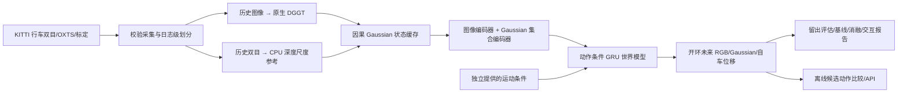

# DriveGaussianWorld

**面向行车场景的因果 Gaussian 世界模型工程。** 以官方 DGGT 预训练模型提取历史几何状态，训练轻量动作条件时序模型，预测未来低分辨率 RGB、Gaussian 表面与自车运动；提供真实数据采集、来源审计、CPU 训练、基线、消融、离线动作比较和推理 API。

项目服务于世界模型/智驾实习中的工程能力展示。当前验收范围是 **真实行车小样本 + 原生 DGGT CPU 推理 + 轻量世界模型训练与离线评估**。不把数据适配器称为模型，不把合成泊车轨迹作为行车结果，也不把开环动作排序称为车辆闭环控制。

## 主流程



- **几何前端**：直接加载 `third_party/dggt` 的 `VGGT` 与已有 Waymo 权重，严格匹配参数，使用上游正式推理中的深度反投影路径。没有用随机网络替代 DGGT。
- **因果缓存**：时刻 `t` 最多使用 `[t-1,t]` 的历史采样图像，每个时刻重新前向；不会用全日志重建结果切片，防止 DGGT 时间注意力泄露未来帧。
- **米制参考**：当前时刻双目 SGBM 深度为 DGGT 提供中位数尺度锚点。仍保留预测相机内参/位姿和尺度误差，不宣称 DGGT 单目输出天然具有米制精度。
- **世界模型**：CNN 图像编码 + masked DeepSets Gaussian 编码 + 历史 GRU + 动作条件 GRU。预测相机局部 Gaussian 状态、残差 RGB 和自车运动；多步 rollout 不读取未来图像或未来几何。
- **监督与评估**：RGB、自车运动、Gaussian 集合距离、有效采样 mask、属性和四元数监督；比较末帧保持、解析刚体运动、RGB-only、无动作输入及 stereo 表征。

## 服务器上直接运行

项目目录：`/home/tiger/Disk/DriveGaussianWorld`。现有环境：

```bash
cd /home/tiger/Disk/DriveGaussianWorld
export DGW_PYTHON=/home/tiger/ProgramFiles/miniconda3/envs/parkings/bin/python
export CUDA_VISIBLE_DEVICES='' PYTHONNOUSERSITE=1
export OMP_NUM_THREADS=2 OPENBLAS_NUM_THREADS=2 MKL_NUM_THREADS=2
$DGW_PYTHON -m drive_gaussian_world doctor
make test PYTHON="$DGW_PYTHON"
```

已有完整产物的入口与实测结果见 [`docs/RESULTS.md`](docs/RESULTS.md)。这份文件在实际实验结束后生成，不能从示例命令推定训练结果。

从零复现整套 CPU 流程（使用新的 run 目录，避免覆盖证据）：

```bash
DGW_PYTHON="$DGW_PYTHON" bash scripts/cpu_pipeline.sh runs/my_cpu_run
```

分阶段执行：

```bash
# 1. 仅选取官方公开 S3 ZIP 内的所需成员；SHA256 + CRC32；支持复用已校验成员。
$DGW_PYTHON -m drive_gaussian_world collect --root data/kitti --frames 128 --stride 4

# 2. 双目几何参考、同步检查、OXTS 标签与数据契约。
$DGW_PYTHON -m drive_gaussian_world prepare --output data/processed/my_stereo
$DGW_PYTHON -m drive_gaussian_world validate --dataset data/processed/my_stereo

# 3. 真正的 DGGT CPU 前向。140 像素输入宽度只用于受限资源工程实验。
$DGW_PYTHON -m drive_gaussian_world dggt-cache \
  --dataset data/processed/my_stereo --output data/processed/my_dggt \
  --width 140 --context 2 --threads 2

# 4. 原始文件完整性与独立 LiDAR 稀疏深度诊断。
$DGW_PYTHON -m drive_gaussian_world audit \
  --dataset data/processed/my_dggt --output runs/my_audit.json

# 5. 主模型、RGB-only、无动作、stereo 对照；全部 CPU。
$DGW_PYTHON -m drive_gaussian_world experiments \
  --dataset data/processed/my_dggt --stereo-dataset data/processed/my_stereo \
  --config configs/cpu_smoke.json --output runs/my_experiments

# 6. 自包含 HTML、GIF、数值指标和反事实动作比较。
$DGW_PYTHON -m drive_gaussian_world demo \
  --dataset data/processed/my_dggt \
  --checkpoint runs/my_experiments/dggt_world/best.pt --output runs/my_demo
```

命令拒绝覆盖已有数据集/实验目录。失败产物保留以便定位问题；重新运行时换一个输出路径。采集器只读复用通过 CRC 的原始成员，可以重复执行。整包下载器 `data.collect` 是可选工具，默认 CLI 使用 `data.range_collect`，不需要下载数 GB 的完整日志。

## 数据集与语义

| split | KITTI raw 日志 | 选取帧 | 平均前向速度 |
|---|---|---:|---:|
| train | `2011_09_26_drive_0005_sync` | 32 | 4.17 m/s |
| val | `2011_09_26_drive_0013_sync` | 32 | 11.42 m/s |
| test | `2011_09_26_drive_0009_sync` | 32 | 10.85 m/s |

每个日志取原始帧 `0,4,...,124`，约 12.8 秒，采样间隔约 0.41 秒。采集左右相机、对应 OXTS、时间戳和标定，额外各取 3 帧真实 LiDAR 作诊断。划分单位是整条日志，附近路线仍可能地理重叠；这不是正式基准划分。

曾检查的 `0018` 初始区间几乎静止，已从主数据集排除，记录见 `docs/data_selection.json`。历史泊车数据、旧输出和归档数据不参与新训练入口。

**动作不是实车控制标签。** 当前条件为由相邻 OXTS 速度/航向变化计算的 `[acceleration_m_s2, yaw_rate_rad_s]`；它们是实现动作条件建模的运动代理，不能称为实测油门、制动或方向盘命令。评估明确区分：

1. `learned_logged_motion`：提供未来日志运动作为条件，评估条件预测。
2. `learned_current_motion`：只用历史观测，未来条件为匀速直行，不提供未来运动标签。
3. `persistence` / `action_warp`：末帧图像及解析刚体运动基线；自车基线使用同样日志运动条件。

RGB 为 `[3,32,96]`；Gaussian 为 `[64,16]`。坐标为相机光学系：右、下、前。字段、归一化单位、mask 和时间契约见 `data/schema.py` 与 [`docs/ARCHITECTURE.md`](docs/ARCHITECTURE.md)。Gaussian 是稀疏可见表面/伪标签，不是占据、车道或可通行区真值。

## 推理 API

默认只监听服务器 loopback，不自动对公网开放：

```bash
$DGW_PYTHON -m drive_gaussian_world serve \
  --dataset data/processed/kitti_dggt \
  --checkpoint runs/driving_cpu/dggt_world/best.pt --port 8765

curl http://127.0.0.1:8765/health
curl -X POST http://127.0.0.1:8765/api/rollout \
  -H 'Content-Type: application/json' \
  -d '{"window":0,"dt":0.4,"actions":[[0,0],[0,0],[0,0],[0,0]]}'
```

返回预测图像、Gaussian、自车位移及来源 anchor，不返回真值未来。API 限制请求长度、动作范围和预测长度，并串行执行模型推理。离线动作比较仅提供研究排序，未连接执行器，没有真实碰撞几何或干预数据支撑安全性结论。

## 工程结构

```text
drive_gaussian_world/
  data/          官方样本采集、来源审计、时间/坐标转换、数据契约、时序窗口
  geometry/      CPU stereo 参考、原生 DGGT 因果缓存
  models/        图像/集合编码、动作条件递归动力学、Gaussian/RGB/ego 解码与损失
  planning/      候选动作的开环比较
  train.py       有预算的 CPU 训练、梯度裁剪、val 选择 checkpoint、来源记录
  evaluate.py    日志条件/无未来条件评估、解析基线
  demo.py        真实留出样例 HTML/GIF/JSON
  serve.py       本地 CPU JSON 推理 API
  experiments.py 配置驱动的主实验和消融
configs/         可执行的 CPU 实验配置
scripts/         全流程复现脚本
tests/           数据契约、泄漏、动作、尺度、checkpoint、报告、采集完整性测试
docs/            架构、数据卡、模型卡、实测结果、面试叙述和资源扩展计划
legacy/parking/  迁移前源代码、测试和 README 的归档，不是默认实验入口
third_party/     原有 DGGT/splatt3r checkout 与许可证，未修改其模型实现
```

新机器可用 Python 3.10 + PyTorch 2.4.1 CPU 环境安装 `pip install -e '.[test]'` 跑核心测试。DGGT 是单独的可选上游运行时，需初始化原有 submodule（源码包可执行 `bash scripts/setup_dggt_source.sh`）并按 `third_party/dggt/README.md` 准备依赖与权重。`.[dggt]` 仅安装适配器常见依赖，不替代上游完整环境。当前服务器已用既有环境验证，环境清单保存在 `docs/environment.txt`；没有升级系统环境或编译 CUDA 扩展。

## 项目边界与后续资源

当前是经过实际验证的 **CPU 工程原型**，不承诺高保真视频生成、长时预测、泛化提升或真实闭环规划。DGGT 使用降低的输入分辨率，世界模型规模与数据量都很小；基线优于学习模型时，照实保留结果。

拿到计算资源后，按 [`docs/RESOURCE_PLAN.md`](docs/RESOURCE_PLAN.md) 扩到原生分辨率 DGGT、nuScenes/Waymo/Argoverse2、随机潜变量与不确定性、独立几何评估和仿真闭环。当前入口没有 GPU 自动选择，也不启动 GPU 训练。

归档与迁移说明见 [`docs/MIGRATION.md`](docs/MIGRATION.md)。已有未提交内容在迁移前完整备份，未自动提交、推送或覆盖远端仓库名称。

## 来源与许可

- DGGT：[官方源码](https://github.com/xiaomi-research/dggt)，Apache 2.0，部分 VGGT 来源文件另见其 `NOTICE`。模型保留上游署名与许可证。
- KITTI：[官方网站与许可](https://www.cvlibs.net/datasets/kitti/)，CC BY-NC-SA 3.0；仅用于符合许可的研究/非商业用途。数据和可识别的派生产物不纳入默认源代码打包。
- KITTI raw 引用：Geiger et al., *Vision meets Robotics: The KITTI Dataset*, IJRR 2013。
- 新增代码的对外发布许可尚由项目所有者决定；不改变原有文件及第三方的许可归属。
