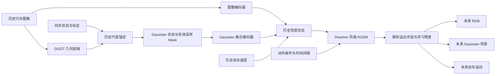

<div align="center">

# DriveGaussianWorld

### DGGT Grounded Dreamer World Modeling for Autonomous Driving

[](https://github.com/Quan2630345594/DriveGaussianWorld/actions/workflows/tests.yml)


**DGGT 几何前端 · 动作条件潜空间动力学 · Gaussian 场景预测**

[技术概览](#技术概览) • [安装](#安装) • [数据准备](#数据准备) • [训练与评估](#训练与评估) • [技术文档](#技术文档) • [引用](#引用)

</div>

DriveGaussianWorld 将预训练 DGGT 的几何重建能力与动作条件时序建模连接起来，面向道路行车序列预测未来图像、局部 Gaussian 场景和自车运动。项目包含数据采集与审计、因果表征缓存、模型训练、基线与消融、可视化报告和推理 API。

## 项目特性

- **原生 DGGT 前端**：冻结上游模型，预测相机参数、深度、Gaussian 属性和动态概率，输出统一的几何状态。
- **因果观测缓存**：每个时刻只重建已观测历史，避免完整视频重建引入未来信息。
- **动作条件世界模型**：融合图像、Gaussian 集合和速度，以递归潜状态建模未来演化。
- **几何运动先验**：结合解析自车运动和学习残差，联合预测场景、观测与自车位移。
- **完整实验接口**：支持 CUDA、GPU 索引、FP16/BF16 训练，提供基线、消融、日志与检查点。

## 技术概览



### DGGT 几何前端

前端直接使用 [xiaomi-research/dggt](https://github.com/xiaomi-research/dggt) 的 `VGGT` 模型。图像经过 patch embedding 和帧内/跨帧交替注意力，多个预测头联合输出相机位姿编码、深度、Gaussian 外观与几何属性以及动态概率。本项目沿用上游 `use_depth=True` 推理路径，由预测深度和相机内外参反投影得到场景点，而不是直接使用 point head 作为最终几何。

对时刻 `t`，缓存只接收 `[t-C+1, …, t]` 的历史帧；每次在当前预测相机系中提取状态，借助当时的双目深度估计尺度。每帧在 **4×16 网格**上选取 **64 个 Gaussian 槽位**，每个槽位为 16 维向量：位置、RGB、不透明度、三轴尺度、四元数、动态概率与置信度。网格槽位是采样位置，不代表持续追踪的物体身份。

尺度锚定为中位数深度比例，并非完整的相机—车体配准；状态仍保留前端预测误差。相机坐标采用 **右、下、前**，位置与尺度分别按 40 m、5 m 归一化。

### Gaussian 世界模型

世界模型采用 Dreamer 风格的连续 RSSM，由确定性循环状态和随机潜状态共同描述场景。当前实现关注动作条件未来预测，不包含 actor、critic、奖励模型或在线强化学习，不能视为完整 Dreamer 复现。

1. **观测编码**：CNN 将 `3×32×96` RGB 编码为 64 维向量；Gaussian 集合经共享 MLP 和 masked mean 编码为 48 维，与速度拼接为 113 维观测特征。
2. **随机动力学**：循环单元根据上一随机状态和 `[a/5, yaw_rate, dt, speed/20]` 更新确定性状态；先验预测随机状态分布，训练时后验额外读取对应观测。历史动作尚未进入观测契约，历史过滤使用零未知控制及已观测速度。
3. **联合解码**：拼接确定性与随机状态，经投影后预测图像残差、Gaussian 属性及自车运动残差。几何分支包含解析自车运动先验，RGB 分支是独立反卷积解码器，不经过 Gaussian 渲染。
4. **开环预测**：测试时仅使用历史观测和给定未来运动条件，未来状态全部从先验采样，不读取未来真实图像或几何。

```text
L_reconstruction = L_rgb + 2 L_geometry + 0.2 L_attributes + 0.05 L_mask + 0.1 L_ego
L_total = L_reconstruction + 0.1 L_balanced_KL
```

默认训练配置为确定性隐藏维度 256、随机维度 64、历史 4 帧、未来 8 帧。KL balance 默认为 0.8，free nats 为 1。图像分辨率为 32×96，64 个几何槽位不代表持久物体身份。详细训练契约与限制见 [RSSM 技术说明](docs/RSSM.md)。

## 技术文档

| 模块 | 文档 | 内容 |
|---|---|---|
| DGGT 前端 | [DGGT 前端技术设计](docs/DGGT_Frontend.docx) | 原生网络结构、深度反投影、坐标转换、因果缓存、尺度锚定与状态契约 |
| 世界模型 | [Gaussian 世界模型技术设计](docs/World_Model.docx) | RSSM 先验后验、预测头、KL 训练目标与开环评估协议 |

## 安装

### 1 创建环境

```bash
git clone --recurse-submodules https://github.com/Quan2630345594/DriveGaussianWorld.git DriveGaussianWorld
cd DriveGaussianWorld
conda create -n drivegaussianworld python=3.10 -y
conda activate drivegaussianworld

# PyTorch 2.4.1 CUDA 12.4 示例；请按驱动选择对应的官方 CUDA wheel。
pip install torch==2.4.1 torchvision==0.19.1 --index-url https://download.pytorch.org/whl/cu124
pip install -e '.[test,dggt]'
```

### 2 准备 DGGT 运行时

```bash
# 非 Git 源码包可使用该脚本获取固定版本的上游源码。
bash scripts/setup_dggt_source.sh
pip install -r third_party/dggt/requirements.txt
mkdir -p checkpoints
curl -L --fail \
  https://huggingface.co/xiaomi-research/dggt/resolve/main/model_latest_waymo.pt \
  -o checkpoints/model_latest_waymo.pth
python -m drive_gaussian_world doctor
```

前端缓存不调用扩散精修或跟踪模块；如单独运行上游完整训练/渲染，请另外遵循其安装说明。依赖冲突时，以 PyTorch、torchvision 和 CUDA 版本匹配为先，避免混装多个 torch 版本。

## 数据准备

当前提供 KITTI raw 适配：同步双目、OXTS、时间戳和标定进入主流程，少量 LiDAR 用于独立深度诊断。示例划分按整条日志隔离：`0005 / 0013 / 0009` 分别用于 train / val / test。

```bash
# 选择公开 ZIP 中所需成员，校验 CRC32 和 SHA256。
python -m drive_gaussian_world collect --root data/kitti --frames 128 --stride 4

# 构建同步序列、运动条件与双目参考几何。
python -m drive_gaussian_world prepare \
  --raw data/kitti/raw --output data/processed/kitti_stereo

# 在 GPU 上构建因果 DGGT 缓存；默认宽度 518，最多 4 帧历史。
CUDA_VISIBLE_DEVICES=0 python -m drive_gaussian_world dggt-cache \
  --dataset data/processed/kitti_stereo --raw data/kitti/raw \
  --output data/processed/kitti_dggt \
  --device cuda:0 --width 518 --context 4 --precision bf16 \
  --memory-fraction 0.35 --resume

python -m drive_gaussian_world validate --dataset data/processed/kitti_dggt
python -m drive_gaussian_world audit \
  --dataset data/processed/kitti_dggt --output runs/data_audit.json
```

DGGT 缓存必须通过 `CUDA_VISIBLE_DEVICES` 绑定一张物理卡，进程内使用 `cuda:0`。`--memory-fraction` 限制 PyTorch 分配器预算，不构成独占显存预留；应结合其他任务留出余量。`--resume` 校验输入清单、模型哈希及缓存参数，并复用已完成的帧。临时帧分片在对应日志完成后清理，不保留原生预测测试文件。

```bash
# 全量 20 条日志、全部 7,915 帧；保留原有日志级划分。
python -m drive_gaussian_world prepare --raw data/kitti_driving/raw \
  --all-collected --stride 1 --output data/processed/kitti_driving_stereo_full
CUDA_VISIBLE_DEVICES=0 python -m drive_gaussian_world dggt-cache \
  --dataset data/processed/kitti_driving_stereo_full --raw data/kitti_driving/raw \
  --output data/processed/kitti_driving_dggt_full --width 280 --context 4 \
  --device cuda:0 --precision bf16 --memory-fraction 0.35 --resume
```

也可运行 `CUDA_VISIBLE_DEVICES=0 bash scripts/cache_driving.sh`，自动依次准备、恢复缓存并校验全量数据。

全量缓存已于 2026-11-24 完成：**20 条日志、7,915 帧，stride 1，训练/验证/测试日志 16/2/2**。来源、模型哈希及逐日志校验结果见 [DGGT 缓存清单](docs/DGGT_CACHE_MANIFEST.json)。

宽度 280 为降低共享显卡负载的工程配置，不是原生 518 宽度基准。每帧仅使用当前和过去图像；尺度锚定失败时保留时间轴并将该帧几何标记为无效，在元数据记录原因，不伪造几何。数据来源、许可和划分限制见 [数据卡](docs/DATA_CARD.md)。

### 扩展行车数据与代理

`download-drives` 按 `configs/data/kitti_driving.json` 下载更多完整行车日志，保留彩色双目、OXTS、时间戳、标定和 LiDAR。按日志划分 train/val/test，先抽查行驶速度；下载前检查源 ZIP 总量及保守磁盘峰值，均低于 50GB。已校验解压的临时 ZIP 会删除，原始传感器文件保留；支持断点续传和逐文件 CRC32/SHA256。

```bash
# 先查看实际文件大小与预算；只读取元数据和少量 OXTS。
python -m drive_gaussian_world download-drives --preflight --root data/kitti_driving
python -m drive_gaussian_world download-drives --root data/kitti_driving
python scripts/verify_raw_collection.py --root data/kitti_driving

# 后续准备全部日志的训练窗口；此步骤会计算双目参考几何。
python -m drive_gaussian_world prepare --raw data/kitti_driving/raw \
  --all-collected --stride 4 --output data/processed/kitti_driving_stereo
```

已完成的扩展子集包含 **20 条行车日志、7,915 个同步时刻**，保留数据及清单约 **28.02GB**，按 **16 / 2 / 2** 条日志划分训练、验证与测试。来源哈希、实际规模和 LiDAR 可用性见 [数据摘要](docs/DATASET_MANIFEST.json) 与 [数据卡](docs/DATA_CARD.md)。

需要代理时，可在本机运行 `ssh -N -R 127.0.0.1:17892:127.0.0.1:7890 <server>`，在服务器显式设置 `DGW_HTTP_PROXY=http://127.0.0.1:17892`。转发只监听服务器回环地址；端口被占用时选择其他空闲端口。默认忽略其他 shell 代理变量，可直接访问官方 S3。`DGW_TRANSFER_WORKERS=16` 可调整每条日志的分块并发数，允许范围为 1 到 32；最多同时处理两条日志。代码和 CI 使用 CUDA 版 PyTorch；在没有 GPU 任务配额时仍可显式选择 `--device cpu` 做小型验证，无需安装 CPU 专用发行版。


## 训练与评估

### 训练世界模型

```bash
python -m drive_gaussian_world train \
  --dataset data/processed/kitti_driving_dggt_full --output runs/world_model \
  --device cuda:0 --precision fp16 \
  --steps 20000 --batch-size 8 --history 4 --horizon 8 --hidden 256 \
  --model-options '{"stochastic":64}'
```

默认设备为 `cuda`；可指定 `cuda:N`，或使用 `--device auto` 自动选择设备。没有可用 CUDA 时，默认路径明确报错；本地调试可显式传入 `--device cpu --precision fp32`。FP16 使用梯度缩放，BF16 需硬件支持；显存占用取决于 DGGT 分辨率、历史长度和训练批大小。

### RSSM 配置

```bash
CUDA_VISIBLE_DEVICES=0 python -m drive_gaussian_world train \
  --dataset data/processed/kitti_driving_dggt_full --output runs/rssm \
  --hidden 256 --history 4 --horizon 8 --batch-size 8 \
  --model-options '{"stochastic":64,"kl_weight":0.1}' --device cuda:0
```

工程只提供 RSSM 世界模型。`--backend rssm` 保留用于检查点和配置显式标记；旧的其他架构检查点不再支持。RSSM 配置位于 `configs/default.json`。评估添加 `--samples 5 --seed 42` 可输出平均样本 ADE、best-of-K ADE 和轨迹离散度。

### 评估与消融

```bash
python -m drive_gaussian_world evaluate \
  --dataset data/processed/kitti_driving_dggt_full --checkpoint runs/world_model/best.pt \
  --device cuda:0 --split test --output runs/world_model/test.json

python -m drive_gaussian_world experiments \
  --dataset data/processed/kitti_driving_dggt_full \
  --stereo-dataset data/processed/kitti_driving_stereo_full \
  --config configs/default.json --output runs/ablations
```

实验包括完整模型、RGB-only、移除动作条件及 stereo 表征对照；基线包括末帧保持、解析刚体运动和匀速运动。输出 RGB L1/PSNR、自车 ADE/FDE、Gaussian 集合距离和有效采样 mask IoU。

**条件协议**：当前动作是由 OXTS 差分得到的 `[acceleration, yaw_rate]` 运动代理，不是实测油门/方向盘命令。`learned_logged_motion` 提供未来日志运动作为条件；`learned_current_motion` 不提供未来运动标签。Gaussian 指标主要针对前端伪标签，不能替代独立真实几何评估。RSSM 先导结果见 [实验记录](docs/RESULTS.md)，并非 GPU 大规模训练结果或基准性能承诺。

### 可视化与推理服务

```bash
python -m drive_gaussian_world demo \
  --dataset data/processed/kitti_driving_dggt_full --checkpoint runs/world_model/best.pt \
  --device cuda:0 --output runs/demo

python -m drive_gaussian_world serve \
  --dataset data/processed/kitti_driving_dggt_full --checkpoint runs/world_model/best.pt \
  --device cuda:0 --port 8765
```

报告包含历史观测、未来图像、Gaussian 表面、自车轨迹和基线对比。API 默认绑定 `127.0.0.1`：

```bash
curl http://127.0.0.1:8765/health
curl -X POST http://127.0.0.1:8765/api/rollout \
  -H 'Content-Type: application/json' \
  -d '{"window":0,"dt":0.4,"actions":[[0,0],[0,0],[0,0],[0,0]]}'
```

动作长度应与检查点的预测 horizon 一致。API 用于离线条件预测，不包含车辆执行器。

## 项目结构

```text
DriveGaussianWorld/
├── configs/                 # 训练与回归配置
├── docs/                    # 两份核心技术 DOCX、数据卡与实验记录
├── drive_gaussian_world/
│   ├── data/                # 采集、同步、契约、窗口与来源审计
│   ├── geometry/            # DGGT 适配与双目尺度参考
│   ├── models/              # 多模态编码、递归动力学、解码与损失
│   ├── train.py             # 训练、混合精度与检查点
│   ├── evaluate.py          # 条件评估与解析基线
│   ├── demo.py              # 可视化报告
│   └── serve.py             # 推理 API
├── scripts/                 # 上游源码准备与完整流水线
├── tests/                   # 契约、因果性、设备路由与集成测试
└── third_party/dggt/        # 固定版本上游模型
```

## 开发与测试

```bash
make test
CUDA_VISIBLE_DEVICES=0 make pipeline DEVICE=cuda CONFIG=configs/default.json
```

测试使用小型 fixture 验证数据与数值契约，不启动完整训练。提交改动时请覆盖坐标、时间或设备相关的回归检查，记录数据与模型来源，并保持训练目标和推理输入之间的因果边界。

## 引用

本项目基于 [DGGT 官方实现](https://github.com/xiaomi-research/dggt) 和 [KITTI raw 数据](https://www.cvlibs.net/datasets/kitti/raw_data.php)。DGGT 及 VGGT 派生文件保留上游许可证与 NOTICE；KITTI 数据遵循 CC BY-NC-SA 3.0，使用和分享数据及派生产物时需遵守其条款。

```bibtex
@article{geiger2013vision,
  title={Vision meets Robotics: The KITTI Dataset},
  author={Geiger, Andreas and Lenz, Philip and Stiller, Christoph and Urtasun, Raquel},
  journal={The International Journal of Robotics Research},
  year={2013}
}
```

DGGT 论文与推荐引用格式请参阅上游仓库。
